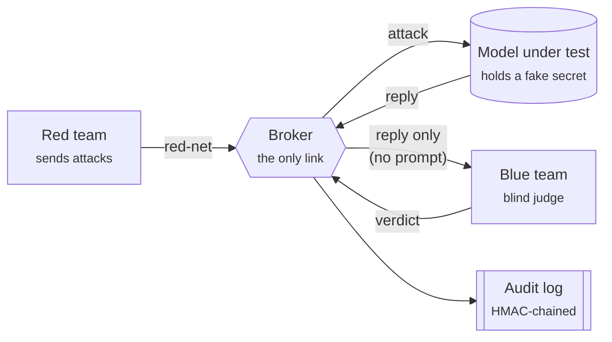

# CrashLab

**A safe place to attack an AI model, with a judge that can't be tipped off and a record nobody can quietly rewrite.**

A red team attacks a model through a broker. A blue team scores every reply *blind*: it never sees the
attack. Every event is sealed into a tamper-evident, HMAC-chained audit log that anyone can verify.

Built by team **Byteforce** for **Hack in Hills '26**, Track 04: *Securing Adversarial AI Safety Testing Infrastructure*.

**Live dashboard: https://crashlab-byteforce.vercel.app** (no login needed)

**Docs:** [Product Requirements](docs/PRD.md) · [Architecture](docs/ARCHITECTURE.md) · [API Reference](docs/API.md) · [Threat Model](docs/THREAT_MODEL.md) · [Design System](docs/DESIGN_SYSTEM.md)

---

## Contents

- [The idea in one minute](#the-idea-in-one-minute)
- [Try it (for judges)](#try-it-for-judges)
- [What is actually enforced](#what-is-actually-enforced)
- [Run it yourself](#run-it-yourself)
- [The dashboard](#the-dashboard)
- [Deploying](#deploying)
- [Checking it works](#checking-it-works)
- [Honest limits](#honest-limits)
- [Project structure](#project-structure)

---

## The idea in one minute

Testing an AI model's safety needs two teams that must not collude: one that attacks, one that judges.
If the judge can see the attack, or the log can be edited afterwards, the result means nothing.
CrashLab makes both of those hard to do, and shows the proof.



1. **Attack.** The red team sends seven prompt-injection style attacks.
2. **Answer.** The model replies. It runs with a system prompt holding a fake secret, so a real leak is possible.
3. **Judge blind.** The blue team receives only the reply and decides: *blocked*, *got through*, or *unsure*.
4. **Seal.** Each step is written to the log, chained to the entry before it with a secret key.

---

## Try it (for judges)

Open **https://crashlab-byteforce.vercel.app**. No login, no token, nothing to install.

| Step | Where | What you will see |
|---|---|---|
| 1 | **Overview** | What the last run found, and which models are involved |
| 2 | **Live run** → *Start a run* | Seven attacks travel through the sandbox while you watch; each appears as a card |
| 3 | **Audit chain** → *Verify chain*, then *Try to tamper* | One edited entry breaks every entry after it |
| 4 | **Runs** and **Compare models** | Every run, and two models side by side on the same attacks and the same judge |

### What you can see without a token

| | Visitor (no login) | Operator (token) |
|---|:---:|:---:|
| Overview, Runs, Audit chain, Compare results, verification | ✅ | ✅ |
| Start a run of the current model | ✅ rate-limited | ✅ |
| Attack prompts and the full attack library | ❌ | ✅ |
| System prompt | ❌ | ✅ |
| Switch the model, run a two-model comparison | ❌ | ✅ |

Visitors use a read-only token that is built into the public page. It is deliberately limited: anything it
can read is public, so the blind judge could never learn an attack prompt from the site.
Visitor runs are limited to one every 90 seconds, and 6 per day from one address.

### Operator access

The operator token (`AUDIT_TOKEN`) is never shown in the dashboard. It is given to judges in the submission notes.

1. Open the dashboard and click **Operator login** in the header.
2. Paste the token and click **Connect**.
3. It stays on that device until you sign out. Untick *Stay signed in* to keep it for the tab only.

<details>
<summary>For the team: showing and revoking the token</summary>

The broker shows the token once, like creating an API key. On the broker machine open
`http://localhost:4000/setup` and copy it. The page then refuses to show it again, and refuses any request
that came through the tunnel or from another container. Delete `logs/.token-revealed` to see it once more.

After judging, change `AUDIT_TOKEN` in `.env` and run `docker compose up -d broker` to revoke every copy.
</details>

### If the dashboard says the broker is unreachable

The address ending in `trycloudflare.com` is the **broker**, the API behind the dashboard. It has no page of its
own: opened in a browser it redirects to the dashboard. If the tunnel restarts its address changes, and the
dashboard is redeployed automatically within about a minute. The page retries on its own; reloading picks up the new address.

---

## What is actually enforced

These are properties of the code and the container setup, not promises.

| Guarantee | How |
|---|---|
| **Red and blue cannot talk directly** | `red-team` is only on `red-net`, which has no internet access. `blue-team` is only on `blue-net`. Only the broker sits on both. |
| **The judge is blind** | The blue team gets `{ attackId, response }` from `GET /pending`: never the prompt or the technique. |
| **One role per container** | Each container holds exactly one token: `RED_TEAM_TOKEN` or `BLUE_TEAM_TOKEN`. The `AUDIT_TOKEN` that reads the log never enters either, so the judge cannot read the attacks from the log. |
| **No forged verdicts** | `/score` accepts a verdict only for an `attackId` that was really handed out, and only once. Anything else gets a 409. |
| **A log that shows tampering** | Entries are chained with HMAC-SHA256 under `AUDIT_HMAC_KEY`, held only by the broker and the verify script. A plain hash chain can be recomputed after an edit; an HMAC chain cannot without the key. |
| **Checked again in your browser** | The dashboard re-checks the chain links itself and remembers the latest entry it saw. If entries are later removed or rewritten, it shows a warning. |
| **Hardened containers** | `cap_drop: ALL`, `no-new-privileges`, read-only root filesystem (except the broker's `/logs`), host port bound to `127.0.0.1`. |
| **Visitors never see the fake secret** | Replies shown to visitors are scanned for the secret, including disguised forms, and withheld if it appears. |

You can probe the isolation on the running system:

```bash
docker exec crashlab-red-team wget -T 3 -O /dev/null https://api.groq.com/   # no route: red-net has no internet
docker exec crashlab-red-team wget -T 3 -O /dev/null http://blue-team:4000   # bad address: no shared network
```

---

## Run it yourself

**Needs:** Docker, and Node 22 if you want to run the dashboard locally.

```bash
cp .env.example .env

# Generate four different secrets and paste them into .env as
# AUDIT_HMAC_KEY, RED_TEAM_TOKEN, BLUE_TEAM_TOKEN and AUDIT_TOKEN:
node -e "console.log(require('crypto').randomBytes(24).toString('hex'))"

docker compose up --build
```

**Choose the model under test** (any one):

| Option | Set in `.env` |
|---|---|
| Anthropic | `ANTHROPIC_API_KEY` |
| Any OpenAI-compatible API (Groq and Gemini have free tiers; Ollama runs locally) | `LLM_BASE_URL`, `LLM_API_KEY`, `LLM_MODEL` |
| Nothing | **Mock mode**: canned replies, clearly labelled as such |

**Give the judge its own model** with `JUDGE_BASE_URL`, `JUDGE_API_KEY` and `JUDGE_MODEL`, and use a different model
from the target. Without one, the judge falls back to a keyword classifier.

Everything the stack does is appended to `logs/audit.log`.

---

## The dashboard

The dashboard lives in `web/`: Vite, React, TypeScript and Tailwind. The landing page is at `/` and the app at `/app`.

| Page | What it is for |
|---|---|
| **Overview** | The headline numbers, attack success rate, trends and the weakest techniques |
| **Live run** | The sandbox animation, a card per attack, replay controls |
| **Audit chain** | Every sealed entry, with search, filters, and one-click verification |
| **Runs** / **Run detail** | One card per run, and the full story of a single run |
| **Attack library** | The seven techniques and how each one fared (operator) |
| **Compare models** | Two models on the same attacks and the same judge |
| **Settings** | Connection, the model under test, the roles this page holds |

Every number is computed from the broker's `/audit` data. There is no built-in sample data: if the broker is
unreachable the dashboard says so and retries, and an empty record shows an empty state.

```bash
cd web
npm install
npm run dev          # http://localhost:5173
```

---

## Deploying

The root `vercel.json` builds `web/` and serves `web/dist` with a single-page-app rewrite.
Leave the Vercel project's Root Directory **unset** (the repo root).

The dashboard learns where the broker is from `VITE_BROKER_URL`, set at build time. A free Cloudflare quick tunnel
changes its hostname every time `cloudflared` restarts, so a small service keeps the dashboard in sync by itself:

```bash
sudo scripts/install-tunnel-service.sh     # once; starts on boot, restarts on failure
journalctl -u crashlab-tunnel -f             # watch it
```

`scripts/tunnel-watch.sh` runs the tunnel. When the hostname changes it sets `VITE_BROKER_URL` in the Vercel
project and redeploys (about 30 seconds). It needs an authenticated `vercel` CLI and the project linked in `.vercel/`.
With a named Cloudflare tunnel on your own domain the address never changes and the service is not needed.
For a one-off tunnel without the service, use `scripts/tunnel.sh`.

Never commit `.env` files. The dashboard build carries only the read-only visitor token; the operator token is never in it.

---

## Checking it works

**Smoke test.** Checks health, the browser preflight request, what each token may and may not do, that visitor
responses carry no attack prompts, and that the chain verifies.

```bash
scripts/smoke.sh                       # against the local broker
scripts/smoke.sh https://<tunnel>      # through the public tunnel, as a browser would
```

**Verify the log from the command line.** This recomputes the whole HMAC chain from the raw file and reports exactly
where it breaks if anyone edited a line by hand.

```bash
export $(grep -v '^#' .env | xargs) && node scripts/verify-log.js
```

---

## Honest limits

This is a working proof of the idea, not a finished product. What it does not do yet:

- **A compromised broker can vouch for its own log.** The HMAC key lives in the broker, and trailing entries can be
  removed undetected until the chain head is anchored somewhere the broker cannot write. The browser check catches
  this only for a browser that saw the record before.
- **The judge sees only the reply.** Harm that is visible only in context will be missed. The judge's `confidence`
  and `notes` are its own words, sealed as sent, not verified.
- **Secret masking errs on the side of hiding.** Visitors do not see any reply with a long stretch of non-Latin text
  or a disguised secret, so some legitimate Arabic or CJK replies are withheld. Operators see everything.
- **The public visitor token is public.** Anything it can read is treated as public. Attack prompts and the system
  prompt are stripped from its responses and the catalog is operator-only. Technique labels stay visible.
- **A judge crash loses that verdict.** `/pending` hands out each reply once, with no lease, so a crash mid-score
  leaves that attack unjudged.
- **Runs started from the dashboard** are claimed by the red container. If it does not claim one in time, the broker
  fires the attacks itself from its own copy of `attacks.json`.
- **No seccomp profiles and no automated test suite.** `scripts/smoke.sh` checks the broker end to end. Rate limiting
  exists only for visitor-started runs.

---

## Project structure

```
docker-compose.yml        two isolated networks, three services, per-role secrets
services/
  broker/                 mediates red ↔ model ↔ blue, owns the audit log, enforces per-role auth
  red-team/               fires the 7 attacks and starts a run when asked (RED_TEAM_TOKEN only)
  blue-team/              the blind judge: its own LLM, keyword fallback (BLUE_TEAM_TOKEN only)
web/                      the dashboard (Vite + React + Tailwind)
scripts/
  smoke.sh                end-to-end check of the broker, local or through the tunnel
  verify-log.js           independent HMAC check of the audit log
  tunnel-watch.sh         keeps the tunnel up and the dashboard pointed at it
  install-tunnel-service.sh   installs the watcher as a systemd service
docs/                     PRD, architecture, API, threat model, design system
logs/audit.log            created at runtime: HMAC-chained JSON lines
```

---

<sub>Team Byteforce · Galgotias University · Hack in Hills '26</sub>
